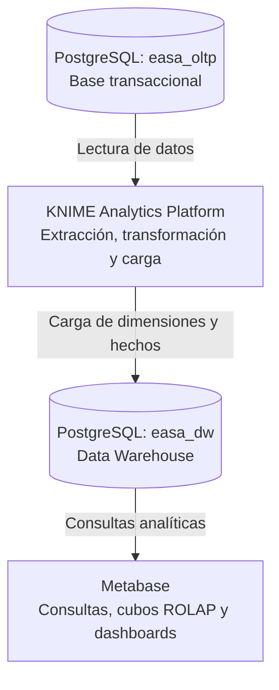

# PPAI Easa — Estado del proyecto y próximos pasos

**Materia:** Sistemas de Soporte a las Decisiones (SSD) — Ingeniería en Sistemas de Información, UTN FRVM  
**Equipo:** Grupo 1 — 2026  
**Etapa actual:** base transaccional preparada; diseño decisional en revisión  
**Repositorio:** [AgusLiendo/SDD_DW_G1](https://github.com/AgusLiendo/SDD_DW_G1)

> **Punto de pausa.** La base `easa_oltp` está creada, poblada y verificada localmente por el equipo; se generó un dump y se incorporó al repositorio. La base `easa_dw` ya existe, pero **continúa vacía**. Antes de crear su esquema o implementar ETL, debemos revisar y ajustar las consultas multidimensionales y el diseño de la entrega 2.

## 1. Introducción

Este Proyecto Práctico de Aplicación Integrador (PPAI) busca desarrollar una parte de un **Sistema de Soporte a las Decisiones (SSD)** para **Easa**, una empresa dedicada a la producción y comercialización de productos panificados, con sucursales en Villa María y Villa Nueva.

El sistema permitirá analizar información histórica sobre ventas, promociones, producción y distribución, compras a proveedores y ajustes de stock. El objetivo no es gestionar las operaciones diarias, sino **transformar los registros operativos en información útil para tomar decisiones**.

El trabajo sigue tres etapas académicas:

1. **Entrega 1 — Análisis organizacional y modelo transaccional:** se describió Easa, sus procesos, niveles de decisión, DER y DIAD.
2. **Entrega 2 — Diseño del Data Warehouse:** se definieron cinco consultas multidimensionales, sus moldes, el modelo Starnet, tablas de hechos y dimensiones y tres sumarizadas.
3. **Entrega 3 — Implementación (etapa actual):** se debe construir un Data Warehouse funcional, desarrollar un proceso ETL desde la base operacional, presentar algunos cubos OLAP y documentar y defender la implementación.

La consigna de la tercera entrega también exige justificar las herramientas utilizadas, describir el procedimiento de implementación y demostrar la solución funcionando ante la cátedra. No exige explícitamente implementar las cinco consultas como cubos; la selección final de cubos queda pendiente de la revisión del diseño.

## 2. Conceptos importantes

| Concepto | Significado en nuestro proyecto |
|---|---|
| **SSD (Sistema de Soporte a las Decisiones)** | Sistema que facilita el análisis de información para apoyar decisiones de la organización. |
| **OLTP (Online Transaction Processing)** | Base transaccional que representa operaciones: ventas, compras, producción, pagos, movimientos de stock, etc. En el proyecto: `easa_oltp`. |
| **Data Warehouse (DW)** | Base decisional que reúne datos históricos, integrados y organizados para consultas analíticas. En el proyecto: `easa_dw`. |
| **ETL (Extract, Transform, Load)** | Proceso que **extrae** datos de `easa_oltp`, los **transforma** según las reglas de análisis y los **carga** en `easa_dw`. |
| **OLAP (Online Analytical Processing)** | Análisis de medidas desde distintas dimensiones y niveles de detalle. |
| **Tabla de hechos (TH)** | Almacena medidas cuantificables de un proceso, por ejemplo unidades vendidas o monto comprado. |
| **Tabla de dimensión (TD)** | Describe desde qué perspectiva se analiza una medida: producto, sucursal, tiempo, tipo de cliente, etc. |
| **Granularidad** | Qué representa **una fila** de una tabla de hechos; hay que definirla antes de diseñar y cargar el DW. |
| **Esquema en estrella** | Una tabla de hechos relacionada con las dimensiones que permiten analizarla. |
| **Constelación de hechos** | Varias tablas de hechos, potencialmente con dimensiones compartidas. Es el enfoque propuesto en la entrega 2. |
| **Starnet** | Modelo conceptual que reúne moldes de consulta de una misma área tema; en nuestro caso se utilizó para las dos consultas de ventas. |
| **Sumarizada** | Tabla con métricas previamente agregadas para responder más rápido determinadas consultas. |
| **Slice / Dice** | Filtrar una dimensión o combinar filtros sobre varias dimensiones. |
| **Roll-up / Drill-down** | Pasar a un nivel más resumido (por ejemplo, mes → año) o a uno más detallado (año → mes). |

**Diferencia clave:** `easa_oltp` conserva los registros operacionales; `easa_dw` tendrá una estructura orientada al análisis. **El DW no reemplaza al OLTP**, sino que se alimenta de él.

## 3. Arquitectura prevista



**Herramientas contempladas** (no confundir con componentes ya instalados/configurados):

- **PostgreSQL + Docker:** motor de las bases operativa y decisional; el entorno local ya aloja `easa_oltp` y `easa_dw`.
- **DataGrip:** cliente que estamos utilizando para inspeccionar bases, editar y ejecutar SQL.
- **KNIME Analytics Platform:** herramienta elegida *provisionalmente* para construir los flujos ETL visuales; **los workflows aún no están implementados**.
- **Metabase:** herramienta prevista para mostrar resultados, filtros, gráficos y análisis tipo ROLAP; **los cubos aún no están implementados**.
- **Git/GitHub:** versionado de scripts, documentación, recursos y entregables.

Como referencia metodológica, se revisó el PPAI del equipo anterior, que utilizó PostgreSQL, ETL y Metabase. Su dominio de negocio es diferente: **no se reutilizan sus consultas ni sus datos**.

## 4. Qué hicimos hasta ahora

### 4.1. Revisión del material académico

- Leímos la consigna de la tercera entrega y revisamos un PPAI de un equipo anterior.
- Contrastamos la **entrega 1** (organización, procesos y DER) y la **entrega 2** (consultas, Starnet, diseño dimensional y sumarizadas).
- Identificamos ajustes que conviene resolver antes de construir físicamente el DW.

### 4.2. Base transaccional `easa_oltp` — completada

Se tomó como referencia el archivo **`DER-Optimizado.png`** de Easa, contrastado con la entrega 1, y se generó un esquema SQL para PostgreSQL que incluye:

- **44 tablas** de la base operacional.
- Claves primarias y foráneas, tipos de datos, índices y restricciones.
- Tablas relacionadas con clientes, productos, insumos, recetas, sucursales, compras, ventas, pagos, cobros, promociones, producción, repartos, stock y auditoría.
- Convención de nombres `snake_case` (por ejemplo, `detalle_venta`, `instancia_de_produccion`).

También se prepararon catálogos iniciales: ciudades, seis sucursales, tipos de cliente, tipos de movimiento, medios de pago y estados.

### 4.3. Datos simulados — completado y validado localmente

Se generó y ejecutó un script de **datos transaccionales ficticios** para probar posteriormente el ETL y el análisis. El período representado es **enero de 2023 a octubre de 2026 (46 meses)**.

Datos principales preparados por el script:

| Conjunto | Volumen planificado por el script |
|---|---:|
| Ventas | 6.900 |
| Compras | 552 |
| Instancias de producción | 690 |
| Ajustes de stock | 690 |
| Productos | 12 |
| Insumos | 16 |
| Clientes ficticios | 94 |
| Proveedores ficticios | 8 |
| Sucursales | 6 |

También se generan detalles de operaciones, cobros, pagos, promociones, repartos, movimientos de stock e información complementaria. **Estas cifras describen lo preparado en el script; los totales efectivamente cargados fueron verificados por el equipo en su entorno local.**

Se ejecutaron las validaciones y el equipo confirmó que la carga terminó correctamente. Los datos **no son históricos reales de Easa**: son simulaciones para desarrollo y demostración académica.

### 4.4. Respaldo y repositorio — completados

- Se creó un **dump de `easa_oltp`** para transportar la base con sus datos a otras computadoras.
- Se creó el repositorio [SDD_DW_G1](https://github.com/AgusLiendo/SDD_DW_G1).
- Se incorporó el dump y se guardaron los scripts de creación, carga y validación en `transaccional/`.
- Se creó la base de datos **`easa_dw`**, actualmente **sin tablas ni datos**.

**Nota sobre el respaldo:** en el repositorio el dump está llamado `transaccional/easa_oltp-dump.sql`. Antes de documentar su restauración, conviene confirmar su formato real: un dump SQL plano se restaura con `psql`, mientras que un dump personalizado (`pg_dump -Fc`) se restaura con `pg_restore`. La extensión no garantiza el formato.

## 5. Organización actual del repositorio

Estructura de la carpeta **verificada** en GitHub:

```text
SDD_DW_G1/
└── transaccional/
    ├── easa_oltp-dump.sql
    └── scripts/
        ├── 00_crear_base.sql
        ├── 02_catalogos_opcionales.sql
        ├── 03_poblar_easa_simulado.sql
        ├── 04_validaciones_easa_seed.sql
        ├── easa_oltp_completo_psql.sql
        ├── easa_oltp_psql.sql
        └── easa_oltp_schema.sql
```

Los archivos principales cumplen estas funciones:

- [`easa_oltp_schema.sql`](transaccional/scripts/easa_oltp_schema.sql): tablas, claves, restricciones e índices.
- [`02_catalogos_opcionales.sql`](transaccional/scripts/02_catalogos_opcionales.sql): datos maestros iniciales.
- [`03_poblar_easa_simulado.sql`](transaccional/scripts/03_poblar_easa_simulado.sql): generación de datos operacionales ficticios.
- [`04_validaciones_easa_seed.sql`](transaccional/scripts/04_validaciones_easa_seed.sql): verificaciones de consistencia y consultas de control.
- [`easa_oltp-dump.sql`](transaccional/easa_oltp-dump.sql): respaldo incorporado al repositorio.

> **Estructura sugerida para más adelante (todavía no creada/confirmada):** `decisional/` para el esquema y validaciones del DW, `etl/` para workflows de KNIME, `olap/` para consultas y dashboards, y `docs/` para la memoria técnica de la entrega.

## 6. Diseño original de las cinco consultas (entrega 2)

Estas son las **definiciones actualmente documentadas**, todavía **pendientes de revisión**:

| N.º | Consulta | Área tema | Medidas y dimensiones principales | Horizonte original |
|---|---|---|---|---|
| 1 | Demanda por producto, sucursal y tipo de cliente | Venta | Unidades vendidas; producto, sucursal, tipo de cliente y tiempo | Últimos 12 meses |
| 2 | Alcance de las promociones | Venta | Monto vendido; promoción, producto, tipo de cliente y tiempo | Últimos 3 años |
| 3 | Producción y distribución entre sucursales | Producción | Unidades producidas; producto, sucursal productora, sucursal destino y tiempo | Último año |
| 4 | Compras y saldos por proveedor | Compra | Monto comprado, pagado y pendiente; proveedor, estado y tiempo | Últimos 18 meses |
| 5 | Ajustes de stock de un producto o insumo específico | AjusteStock | Cantidad de ajustes y unidades ajustadas; **insumo**, sucursal y tiempo | Últimos 6 meses |

La entrega 2 agrupa las consultas **1 y 2** mediante un Starnet de **Ventas** y propone una **constelación de hechos** con cuatro áreas tema. También define tres sumarizadas:

1. **Ventas por sucursal y segmento:** monto de ventas por sucursal, tipo de cliente y trimestre, en los últimos seis meses.
2. **Dependencia de las promociones:** porcentaje de unidades promocionadas por producto y tipo de cliente, durante los últimos cinco años.
3. **Consumo promedio de insumos por instancia:** promedio de insumo utilizado por instancia productiva, insumo y sucursal, durante el último año.

**Estas consultas, dimensiones, métricas y sumarizadas no deben considerarse definitivas.** El equipo acordó revisar esta parte antes de continuar con el DW.

## 7. Temas a resolver antes de implementar `easa_dw`

Los siguientes son **puntos técnicos de revisión**, no cambios ya aprobados:

- **Consulta 1:** confirmar si se mantiene solo cantidad vendida o si también se añade monto vendido.
- **Consulta 2:** diferenciar claramente monto total de ventas, monto con promoción y unidades promocionadas. Los porcentajes se calculan a partir de numerador y denominador; **no se suman porcentajes**.
- **Consulta 3:** no multiplicar la producción al unir cada detalle de producción con varios repartos. Determinar cómo representar por separado unidades producidas y unidades distribuidas.
- **Consulta 4:** distinguir saldo pendiente **actual** de saldo histórico **a una fecha**; agregar compras y pagos por separado antes de unirlos para evitar multiplicaciones en relaciones 1:N.
- **Consulta 5:** resolver la discrepancia entre el título («producto o insumo») y las dimensiones definidas (solo **insumo**); acordar cómo medir ajustes positivos y negativos.
- **Sumarizadas:** comprobar que sean calculables con las tablas y granularidades finales. En particular, revisar la sumarizada de consumo de insumos y el período de cinco años de dependencia promocional, ya que el dataset simulado contiene 46 meses.
- **Granularidad:** definir explícitamente qué representa cada fila de cada tabla de hechos y cuáles son sus claves y medidas aditivas, semiaditivas o no aditivas.
- **Historia temporal:** dejar clara la política de agregación por mes/trimestre/año y el tratamiento de cambios de precios, promociones y estados de compras.

Las definiciones revisadas deben mantenerse consistentes con las entidades y datos que existen en `easa_oltp`. Si una nueva consulta requiriera información inexistente, habría que evaluar un cambio de alcance o una ampliación del origen, en vez de asumir que ya está disponible.

## 8. Estado actual de cada componente

| Componente | Estado |
|---|---|
| Entrega 1 — análisis y DER | ✅ Documentado |
| Entrega 2 — consultas y diseño original | ✅ Documentado; **pendiente de correcciones** |
| PostgreSQL en Docker | ✅ En uso local |
| `easa_oltp` | ✅ Creada, poblada y verificada por el equipo |
| Dump de `easa_oltp` | ✅ Generado y subido al repositorio |
| Repositorio GitHub | ✅ Creado y con carpeta `transaccional/` |
| `easa_dw` | ✅ Base creada, **vacía** |
| Diseño dimensional definitivo | ⏸️ A la espera de revisar la entrega 2 |
| Tablas de hechos y dimensiones físicas | ⬜ No creadas en `easa_dw` |
| Workflows ETL en KNIME | ⬜ No implementados |
| Cubos / dashboards en Metabase | ⬜ No implementados |
| Informe final y defensa | ⬜ Pendientes |

## 9. Próximos pasos cuando retomemos

1. **Revisar y acordar las cinco consultas multidimensionales.** Definir su versión final: preguntas de negocio, dimensiones, horizontes temporales y medidas.
2. **Actualizar el diseño conceptual.** Corregir los moldes, el Starnet, la constelación y las tres sumarizadas que correspondan.
3. **Definir la granularidad y el mapeo origen → destino** para cada hecho y dimensión, usando las tablas reales de `easa_oltp`.
4. **Crear el esquema de `easa_dw`** mediante scripts SQL versionados desde DataGrip.
5. **Construir ETL en KNIME**, primero dimensiones y luego hechos; comprobar integridad y que las recargas no dupliquen datos.
6. **Conciliar OLTP y DW:** comparar cantidades, importes y saldos para las mismas fechas y filtros.
7. **Configurar Metabase y construir algunos cubos OLAP** con filtros y navegación multidimensional.
8. **Documentar la investigación, el paso a paso y las pruebas**, y preparar una demostración reproducible para la defensa oral.

**Primer hito técnico al retomar:** cerrar una versión definitiva de las consultas y del modelo dimensional. **No crear todavía las tablas de `easa_dw` usando el diseño que se está por modificar.**

## 10. Criterios de aceptación para la tercera entrega

Antes de dar la implementación por terminada, deberíamos poder demostrar que:

- El origen (`easa_oltp`) y el destino (`easa_dw`) están correctamente separados.
- Las tablas del DW responden a las consultas revisadas y tienen granularidades justificadas.
- El ETL extrae, transforma y carga datos de forma reproducible.
- Los resultados cargados se verifican contra el origen, sin duplicaciones accidentales.
- Hay algunos cubos OLAP funcionando y se puede filtrar, agrupar y cambiar el nivel de detalle.
- El equipo puede explicar las herramientas, las decisiones de diseño, los problemas encontrados y sus soluciones.
- Otro integrante puede levantar o restaurar el entorno siguiendo el README y los scripts versionados.

## 11. Fuentes de referencia

**Material de nuestro PPAI:**

- `PPAI_Entrega1_SSD_G1.pdf` — organización Easa, procesos y modelo transaccional.
- `DER-Optimizado.png` — diagrama utilizado para construir la base OLTP.
- `PPAI_Entrega2_SSD_G1.pdf` — consultas multidimensionales, Starnet, constelación y sumarizadas.
- `Consigna.md` — condiciones específicas de la implementación de la tercera entrega.
- `PPAI_Anterior.pdf` — referencia de enfoque y documentación; **no** es nuestro modelo de datos.

**Artefactos técnicos:**

- Carpeta [`transaccional/`](https://github.com/AgusLiendo/SDD_DW_G1/tree/main/transaccional) del repositorio.
- Archivos SQL de esquema, catálogos, poblamiento y validación listados arriba.

---

**Resumen de una línea:** terminamos y respaldamos el **origen transaccional**, dejamos creada pero vacía la **base decisional** y pausamos la implementación hasta revisar las **consultas y el modelo dimensional de la entrega 2**.
